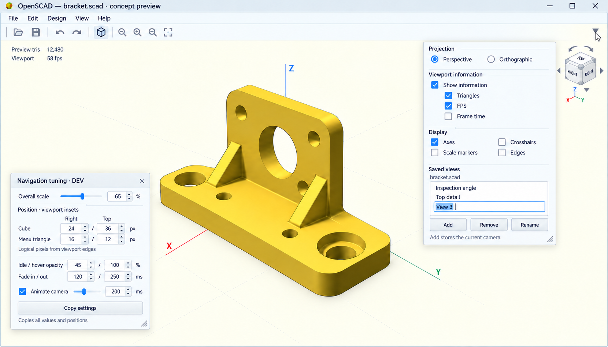

# OpenSCAD navigation cube

## Intent and state

Add a viewport navigation cube in the spirit of FreeCAD and other CAD applications: communicate the current camera
orientation and make common views easy to reach without memorizing mouse gestures or keyboard shortcuts.
The user requested this feature, its own worktree, a pinned chat, and research into appearance, trade-offs and
related functionality. Product choices were supplied on 2026-10-01 and are recorded below. Work remains in exploration;
implementation and a build are not yet requested.

- Source: `D:/openscad/wt-openscad-navigation-cube`, branch `feature/navigation-cube`.
- Repository: shared `D:/openscad/openscad-master` clone; push remote `origin` (roel-v/openscad).
- Base: freshly fetched `upstream/master`, `464e25dad0c01af5488375c15aa6734190531eb5`, on 2026-10-01.
- Submodules initialized at the base's recorded revisions. No source changes, commits, push or PR at setup.
- Plans stay here in the workspace control repository, outside the OpenSCAD checkout.
- Dedicated pinned chat: **OpenSCAD navigation cube**, ID `01a0f642-af9c-7750-a262-6a25a37ab61d`.
- Reuse shared vcpkg packages under `D:/openscad/openscad-6991/build/vcpkg_installed` when building later;
  see `experimental/profiles/windows-x64.md`. Disable manifest installation. No private dependency rebuild.

The master checkout itself was not moved. The annotation and experimental worktrees remain separate.
The dedicated chat should continue from this exploration, rather than start implementing implicitly.

## Accepted direction, 2026-10-01

The user's choices supersede the narrower initial recommendation later in this research:

- Labeled cube with a chamfered appearance, 26 face/edge/corner targets, and axis letters.
- Fixed upper-right anchor. Orientation changes preserve the current projection mode.
- One unobtrusive, unframed triangle at the viewport's upper-right corner, above/right of the cube, opens a resizable
  viewport dialog. Replace the first mockup's three button-like dropdowns with this single entry point.
- This viewport dialog is a popup with a thin frame, no title bar or close button, and dismissal on clicking outside it.
  Retain resizability. The temporary developer tuning window is separate from this popup.
- The dialog has Perspective and Orthographic radio buttons, never a projection combo box.
- Saved views: a nearby way to store and recall camera positions, owned per document and persisted beside its SCAD
  file in a separate companion, following the annotation approach. Keep the experimental format simple and independent;
  a better unified format may follow later. Exact camera recall semantics remain to be designed.
- Configurable camera animation, plus roll and directional arrows. Exact increments and defaults remain open.
- The same dialog toggles viewport information, including triangle count and FPS, plus axes, crosshairs, edges and
  other useful viewport options. Blender's statistics overlay remains the reference for the information readouts.
- Saved views appear in a small list with Add, Remove and Rename buttons below. Add captures the current camera,
  assigns a default name and starts inline name editing so renaming is optional.
- Transparency with experimentation around becoming opaque on hover, including opacity levels and transition timing.
- A temporary developer tweak-settings window for live experimentation and choosing the final defaults, including
  overall cube/control scaling. The first mockup is too large; start the next preview smaller.
- Developer controls independently adjust the locations of the cube and menu triangle and show their numeric values.
  One Copy settings button copies a description of all current settings, including positions, for pasting into chat.
- A focused collection of viewport controls; investigate which existing commands belong here without reproducing
  the entire View menu as a separate control set.

Drag-orbit, corner up rules, Home behavior and saved-view recall semantics remain unresolved. The visual direction and
popup structure are accepted; exact dimensions, placement and appearance values will be tuned experimentally.
These choices authorize continued design exploration; they do not request starting a source implementation or build.

### Accepted visual reference and completeness audit

The user accepted the fourth preview: a compact cube and discreet corner triangle, with the thin-framed viewport popup
open over the scene and a separate developer tuning window. This supersedes earlier previews with three dropdown
buttons, large navigation controls, or a window-style viewport-dialog header.

This image was generated with the built-in image tool and saved here as a design reference, not implementation
evidence. The editing prompt specified removal of the right-hand popup's title bar and close button, retention of its
thin frame and resize grip, and preservation of the other controls, cube, scene and separate developer window.
The visible percentages, offsets, timings, model and statistics are illustrative, not approved default values.
The drawn triangle's precise relationship to the application toolbar is not authoritative: its anchor is the viewport.

The requirements audit covers every user decision through approval of this preview: cube appearance/26 targets/axis
letters; fixed but developer-tunable placement and scale; preserved projection on navigation; radio-button projection
control; popup framing/resizing/outside-click dismissal; viewport information/display toggles; per-document saved views
and companion storage; Add/Remove/Rename and immediate optional name editing; configurable animation/roll/arrows;
transparency experiments; and a single clipboard export of all current settings and positions.

The accepted popup groups Projection, Viewport information, Display and Saved views. The preview shows a master
information toggle with individual Triangles, FPS and Frame time toggles, plus Axes, Scale markers, Crosshairs and Edges.
These groups provide the baseline for formal requirements. Data definitions and camera interaction details below still
need explicit requirements or identified implementation proposals; visual approval does not settle those implicitly.

## Research scope and evidence

Research date: 2026-10-01. Sources below are official documentation, vendor illustrations and local source code.
FreeCAD and Onshape reference images were visually inspected in the browser. Other behavior comes from vendor
documentation; no claim is made that each commercial application was operated or that every edition is identical.
The SOLIDWORKS reference is explicitly the 2023 documentation, not a verified current-release UI.

### FreeCAD: primary visual reference

The official illustration shows a pale, outlined, chamfered cube with readable TOP, FRONT and RIGHT labels, distinct
edge strips and corner patches, four surrounding triangular arrows, two curved arrows above, a circular reverse
button at upper right, a mini-cube menu at lower right, and colored axes. The cube normally sits at upper right.
Its 6 main faces, 12 edge faces and 8 corner faces give 26 targets. Arrows rotate/roll the view; reverse turns it
180 degrees about the view's vertical axis. The menu includes projection, isometric, fit and selection-related
commands. An optional movable mode drags the widget itself. [FreeCAD navigation cube][freecad]

The FreeCAD project specifically enlarged corner targets to improve usability. This is useful evidence for making
edge/corner hit regions deliberate, rather than expecting users to click mathematical lines/points.
[FreeCAD corner-target improvement][freecad-targets]

### Autodesk Fusion / ViewCube family

Fusion documents a cube at the canvas's upper right: labeled faces select principal views, corners select isometric
views, dragging the cube orbits the camera, and a nearby Home control restores the home view. Named Views are related
but live in the browser. Its navigation bar separately provides pan, zoom, orbit, look-at and fit.
[Fusion illustrated navigation guide, pages 3–4][fusion]

Autodesk's Model Coordination documentation adds explicit face/edge/corner targets, face-adjacency arrows, 90-degree
roll arrows, and context-menu projection choices including perspective with orthographic face views. It also exposes
home customization and front/top redefinition. These are evidence for the wider ViewCube family, not a claim that
every Autodesk product exposes the same menu. [Autodesk Home and ViewCube][autodesk]

An additional Autodesk product distinguishes a fixed-distance Home from a Home that fits the current model extents.
That distinction matters when an OpenSCAD parameter changes the size of the model. [ViewCube menu][home]

### Onshape

The illustrated cube is pale and compact, with labeled faces, colored XYZ axes, surrounding arrows, and a separate
small cube/dropdown below it. That dropdown collects camera and rendering settings rather than putting all controls
on the cube. [Onshape camera/render menu][onshape-menu]

Its desktop documentation specifies 15-degree arrow steps, Shift for 90 degrees and Ctrl for 5 degrees. Face clicks
select principal views; corner clicks are documented as **trimetric**, so “corner means isometric” is not universal.
Touch versions use a view menu and a rotation lock. [Onshape navigation][onshape]

Named views, previous view, fit/window/selection zoom, projection, shading, hidden/tangent edges and section view are
nearby functionality. These are separable features, not all necessary to implement a navigation cube.
[Onshape camera/render menu][onshape-menu]

### SOLIDWORKS: an alternative interaction model

The 2023 View Selector is an invoked, contextual cube around the model, reached through Ctrl+Space or the Orientation
dialog. It offers hover previews and access to rear planes with Alt; obscured planes can be spread out. Corner views
can use isometric, dimetric or trimetric orientation, and animation speed is configurable. This optimizes view
selection in context rather than a permanently small corner control. [SOLIDWORKS View Selector][solidworks]

### Blender: useful contrast

Blender uses an axis-based navigation gizmo rather than a labeled six-face cube. Its documented gizmo supports orbit,
axis alignment and selecting the opposite side by clicking the same axis again, alongside other navigation controls.
This offers a compact comparison but is not the requested cube design. [Blender navigation introduction][blender]

## What should transfer to OpenSCAD

The table reconciles the research with the accepted direction. Items explicitly marked proposed still need resolution;
accepted choices are not reopened by the research comparisons. The references do not establish one universal behavior.

| Design choice | Trade-off | Current direction |
| --- | --- | --- |
| Labeled cube versus axis gizmo | Cube labels are approachable; axis gizmos take less space | FreeCAD-like labeled/chamfered cube with XYZ cues |
| Six targets versus 26 | Six is simpler; edges/corners make oblique inspection much faster | Accepted: 26 total targets; only front-facing visible facets are clickable at a given orientation |
| Position | Fixed avoids accidental relocation; movable can uncover geometry | Accepted: upper-right anchor, independently adjustable cube/triangle positions in dev controls |
| Drag semantics | Orbit matches Fusion; relocation matches optional FreeCAD behavior | Never drag to relocate; evaluate orbit drag separately from click snapping |
| Face click and projection | Automatic ortho is CAD-friendly but silently changes camera mode | Accepted: preserve projection; change it explicitly using popup radio buttons |
| Corner view | True isometric is predictable; OpenSCAD's current Diagonal differs | Proposed: true isometric corners with a stable up rule, preserving existing Diagonal separately |
| Zoom/pivot | Auto-fit keeps model visible but disrupts close inspection | Proposed: orientation clicks preserve pivot/pan/distance; Fit All stays explicit |
| Home | Reset camera, standard oblique view and stored view are different actions | Proposed: existing Reset View semantics; no new configurable Home |
| Roll/arrows | Useful orientation control, but increase clutter and hit-target competition | Accepted controls; step sizes, repeated input and opposite-view shortcut unresolved |
| Animation | Helps spatial continuity; slows repetitive work and complicates interruption | Accepted: configurable animation; duration/easing and interruption policy to specify |
| Axes and labels | Color alone is inaccessible; longer translated labels may crowd faces | Text labels plus axis letters, theme-aware contrast and logical-pixel sizing |
| Always visible versus hover fade | Fading preserves model space but harms discoverability | Visible at modest opacity, stronger hover feedback; test both themes |
| Menus | Convenient access can become a second giant View menu | Accepted: one thin-framed resizable popup; remaining View-menu coverage unresolved |

The user's annotation-palette correction is relevant: dragging a floating viewport control caused repaint streaks,
and the user preferred a fixed control with an arrow cursor. Apply that lesson to this proposal, while keeping
widget relocation distinct from dragging to orbit the model. The latter still needs an explicit scope decision.

## Related functionality and scope boundaries

**Natural companions:** standard views, edge/corner views, roll, opposite view, reset, fit all, perspective/orthogonal,
visibility and size preferences, hover feedback, tooltips, keyboard-accessible equivalents and camera synchronization.

**Now explicitly requested:** saved views, configurable camera animation, roll/arrows, integrated projection control,
one resizable viewport dialog for projection/overlays/saved views, and a temporary developer tuning window.

**Potential later extensions or unresolved policies:** previous-view history, user-defined Home, fine rotation
increments, drag-orbit, end-user relocation controls, and reduced-motion preference. Developer position tuning is
explicitly in scope. Automatic projection changes
on orientation snaps are excluded by the accepted preserve-projection choice.
Saved views use their own per-document companion file while this feature is independent of annotations. A unified
format is a possible later change, not a prerequisite for experimentation.

**Not implied by this feature:** editing geometry, redefining world axes, rotating the SCAD model, selection-dependent
fit/normal alignment, clipping/section planes, north compass/ground-plane semantics, new rendering modes, touch UI,
or a new agent API. These exist in some reference applications but need separate justification in OpenSCAD.

First implementation should work on the ordinary upstream viewport without depending on the annotations branch.
Later composition must respect its camera locks and screenshot rules; it must not require annotation object picking.

## Mapping to the OpenSCAD source

Inspected at the recorded upstream base:

- `src/gui/MainWindow.cc`: existing Top/Bottom/Left/Right/Front/Back/Diagonal slots, Reset View, View All and projection.
  Face actions directly assign `qglview->cam.object_rot` and call update. They do not consistently route through a
  single camera-change notifier, so listening only for mouse-driven `cameraChanged` can leave a cube out of sync.
- `src/gui/QGLView.cc/.h`: native viewport input, repaint and cameraChanged. Candidate widget owner/input boundary.
- `src/glview/Camera.cc/.h`: native camera state, projection, reset, fit and SCAD camera-variable conversion.
- `src/gui/ViewportControl.cc` and `src/gui/Animate.cc`: existing camera consumers; preserve their updates and behavior.
- `src/gui/Preferences.*` and existing View actions: integration points for visibility/size and standard shortcuts.

Current internal orientation table (object_rot, not directly SCAD $vpr):

| View | Internal rotation |
| --- | --- |
| Front | (0, 0, 0) |
| Back | (0, 0, 180) |
| Left | (0, 0, 90) |
| Right | (0, 0, 270) |
| Top | (90, 0, 0) |
| Bottom | (270, 0, 0) |
| Diagonal | (35, 0, -25) |

Camera::setVpr maps public angles to (90-x, -y, -z), with wrapping. Reset View uses public (55,0,25), resets
translation/distance/FOV, and is therefore more than an orientation click. Do not transplant FreeCAD quaternions
or axis labels without tests against OpenSCAD's actual camera basis. A true isometric corner must have equal axis
foreshortening under orthographic projection; the existing approximate Diagonal angles are not a definition of it.

Prefer one camera-operation boundary shared by cube commands and existing menu commands. Preserve source/Customizer
dirty state for navigation, selection, render-result ownership, projection action checks and cameraChanged consumers.
Saved-view metadata edits need their own persistence/dirty-state policy, unlike simply navigating the camera. The cube
should neither rewrite SCAD nor introduce geometry compilation as a prerequisite to navigation. Existing Animate
behavior is an integration constraint: `Animate::cameraChanged` calls `animateUpdate`, which can schedule reevaluation
when its panel is visible and its FPS is zero. Avoid new evaluation storms from interpolation-frame notifications while
preserving existing final camera-change behavior. Camera transitions are distinct from `$t` model animation.
SCAD $vpr/$vpt/$vpd/$vpf can
override the view during a later evaluation; show that actual resulting orientation without fighting the script.

### Rendering and interaction options

1. **Qt child widget with projected polygons/QPainter:** reuse Qt/Eigen, draw a small cube from camera orientation,
   depth-sort visible facets and hit-test the same polygons. Offers native hover/cursor/tooltips and can stay outside
   raw framebuffer captures. Must verify QOpenGLWidget composition, transparent-background invalidation, DPR changes
   and mouse propagation. Use enlarged logical hit regions without overlapping face/edge/corner ambiguity.
2. **OpenGL overlay pass:** shares viewport rendering and permits depth-based picking, but must restore GL state and
   explicitly suppress the cube during exports/captures. Requires more care across preview/render and headless paths.
3. **Separate 3D widget/library:** isolated but adds contexts, composition and possibly dependencies. No demonstrated
   need for Coin3D or another CAD framework just to draw this widget; not the preferred starting point.

Prototype option 1 with a fixed anchor and opaque/transparent repaint checks. Derive display and hit-test geometry
from the same orientation. Use a consistent rotation representation for targets; proposed animated transitions use
shortest-path quaternion interpolation, converting through a tested native-camera adapter at the boundary.
Corner views need an explicit up/roll rule to avoid unexpected upside-down snaps.

Local FreeCAD source was also located at `D:/source/github-freecad/FreeCAD`, inspected revision
`b81314fdcf249388dc111117ba9bc5e2d569df82`: `src/Gui/NaviCube.cpp/.h` and `Inventor/SoNaviCube.*`.
It is a reference implementation, not a library dependency or evidence of this checkout's running UI version.

## Annotation and application integration

- The annotation worktree's fixed palette is at upper left; a proposed upper-right cube avoids that default overlap.
  Test narrow viewports and other toolbar/overlay layouts instead of relying on one window size.
- During a marked annotation draft or pending capture, cube camera operations must obey the same lock as ordinary
  navigation. No hidden backdoor through face clicks, context menu, drag, roll or animation callbacks.
- Before marks/after undo-all, permitted cube navigation must invalidate stroke redo just like normal camera movement.
- Proposed screenshot behavior: exclude cube chrome from exported/model evidence images, while retaining camera
  metadata. Full-window UI screenshots may include it. Verify actual capture paths before committing to this policy.
- Bind each cube to its viewport/window. Switching the active editor must not imply a different rendered model or
  silently open/activate another document. Compilation and failed/empty results must leave orientation display sane.
- Integration against annotations and the selected experimental stack is a later test, not a reason to merge those
  branches into this feature now. PR-stack inclusion remains a manual selection.

## Validation to plan before implementation

- Asymmetric XYZ-labeled fixture: six face mappings, twelve edges, eight corners, up direction and opposite/roll cycles.
- Menu, mouse, viewport-control fields, SCAD camera variables and cube all stay synchronized; pan/zoom remain stable.
- Facet hit testing at boundaries, hover exit, pointer release outside, rapid clicks, repeated clicks and optional
  drag threshold; cube input never accidentally selects geometry or creates annotation strokes.
- Light/dark themes, translated labels, arrow cursor, 100/125/150/200% and mixed-monitor DPI, resize/hide/show,
  maximized/narrow/fullscreen windows; no trails, stale highlights or clipped targets.
- Preview, thrown-together and F6 render; both projection modes; empty/error result; several windows/documents.
- Configurable animation and interruption: new click, manual orbit, compile, source reload, capture and closing the view.
- Popup opens from the triangle, resizes without dismissal, hides on outside click, and has no title bar or close button.
  Verify inline name editing when focus leaves, and define whether the dismissing click reaches the viewport beneath.
- Saved-view Add captures the current camera and starts optional name editing; Remove/Rename affect the selected entry.
  Verify recall, persistence/reopen, untitled documents, Save As/copy and separation from annotation data.
- Developer scale/position/opacity/timing changes apply live; inspectable positions and Copy settings match current
  values after resize and DPI changes, including settings not visible in the shortened concept preview.
- Capture/export excludes controls as specified, with no camera race and no change to output geometry/source dirty state.
- Windows build using existing shared dependencies and an incremental application build directory. No dependency
  install, new ZIP packaging or other worktree update merely to validate a small navigation change.

## Control layout and behavior investigation, 2026-10-01

The first rendered concept used three dropdown buttons below a large cube. The user requested a smaller footprint and
replaced those controls with a single discreet triangle in the extreme upper-right corner, above/right of the cube.
It should not look like a button. Keep an adequate invisible hit area, tooltip and keyboard focus feedback while
retaining the light visual treatment. Cube, roll/directional arrows and axis letters remain fixed in this corner.

Clicking the triangle opens one resizable viewport popup with a thin frame, no title bar and no close button. Clicking outside
hides it, as explicitly requested after the in-action mockup; the mockup's window-style close control is superseded.
Proposed behavior is live application of settings, Escape dismissal, remembered size, a saved-view list that grows
when resized, and on-screen placement. Keep popup interactions, including inline name editing and resizing, from
triggering outside-click dismissal. These finer behavior details are proposals; resizability, thin frame, no close
button or title bar, outside-click dismissal and the following controls are user requirements.

| Control | Proposed behavior | Remaining design |
| --- | --- | --- |
| Projection | Two radio buttons: Perspective and Orthographic; share existing application state | Accessible layout and focus |
| Saved views | Small list; Add / Remove / Rename buttons below; Add captures camera and begins editing a default name | Recall gesture, exact camera state and projection recall |
| Overlays | Viewport information on/off plus axes, crosshairs, edges and related options in the same dialog | Grouping, metric definitions, text location and performance overhead |
| Roll/arrows | Rotate around the view direction or step around the model | Step sizes, modifier keys, hold/repeat and stable up rules |

Reuse existing actions and checked state wherever possible so toolbar/menu/viewport controls agree. The user expects
the cube and dialog to cover most View-menu use, perhaps except Animate. The inspected `MainWindow.ui::menu_View`
also contains Preview/Thrown Together, Center, View All, Reset View, Zoom In/Out and toolbar visibility, besides the
standard orientations and display/projection settings. Therefore the current dialog does not yet cover every entry.
Fit/Center/Reset are natural candidates for a small additional row; render modes and application-layout controls need
an explicit scope decision. Inspect dynamically added actions before claiming complete coverage. Removing the actual
View menu is not settled by this comparison; preserve shared commands and keyboard access during exploration.

### Saved views

A useful saved camera needs orientation, translation/pivot, distance and field of view, not orientation alone.
Whether projection belongs in recall is an explicit remaining choice: preserve-projection is already settled for cube
orientation clicks, but should not be silently reinterpreted for saved views. Avoid automatic fitting when recalling a
precise stored position. Script camera overrides on later evaluation remain an integration concern.

The user confirmed per-document ownership and a separate companion file beside the SCAD file, like annotations.
The annotation convention is `model.scad.annotations`; the saved-view feature must use a distinct companion and remain
independent. `model.scad.views.json` is a possible experimental filename, not a required final naming or format choice.
Use a simple format suitable for experimentation; do not delay the feature to design a unified metadata container.
A future unified format may combine these stores, but no migration or annotation-file changes are requested now.

Keep view names and camera data out of SCAD source. Plan untitled-document behavior, Save As/Save a Copy, reopening,
manual copying/moving of source plus companion, and multiple-window handling consistently with document ownership.
The viewport dialog contains the list and its Add / Remove / Rename buttons. Add snapshots the current camera first,
creates a unique default name such as View 1, selects the new row and starts inline editing. Keeping the default name
must be valid. Rename edits the selected name; Remove targets the selected stored entry. Disable selection-dependent
buttons with no selection. Choose recall behavior so beginning a rename cannot unexpectedly move the camera.
Storage encoding and filename are routine implementation choices; what camera state recall restores remains open.

### Overlays and statistics

Blender's official documentation separates text information such as playback FPS from geometry statistics, whose
meaning depends on mode and selection. Borrow the discoverable popover and optional readouts, while defining OpenSCAD
metrics for its own preview/render pipeline. [Blender viewport overlays][blender-overlays]

Read-only source inspection at `464e25dad0c01af5488375c15aa6734190531eb5` found:

- `src/gui/MainWindow.ui` already defines Perspective/Orthogonal, Show Axes, Show Scale Markers, Show Edges and
  Show Crosshairs actions. These are candidates for shared controls in the cluster, not new independent settings.
- `src/RenderStatistic.cc` exposes geometry-dependent statistics and rendering time through output visitors.
  A PolySet's facets are called triangles only when it is triangular; CGAL and Manifold have different reporting paths.
  Do not relabel every facet count as a triangle count.
- `src/glview/VBOBuilder.cc` tracks triangles while constructing draw data. This is a candidate input for preview
  geometry statistics, not proof of a final Boolean-result triangle count or total GPU work across rendering passes.
- `src/gui/Animate.cc` uses the FPS field to request animation timer intervals. That value is not measured viewport FPS.
  `src/gui/QGLView.cc::paintGL` currently paints and updates camera status; measurement needs a dedicated design.
- `src/glview/Camera.h` contains translation, rotation, distance, field of view and projection state for saved-camera
  design. No saved-view or named-view implementation was found by the bounded GUI/GLView text search; this is not an
  exhaustive absence claim across the repository.

Initial overlay candidates: triangles with an explicit preview/render meaning, measured viewport FPS, optional frame
time, and existing axes/scale markers/crosshairs/edges. Model bounds and last compile/render duration are possible later
readouts. Avoid expensive per-frame geometry recounting or forcing an F6 render just to display statistics. Distinguish
idle from slow rendering; do not repaint continuously solely to keep an FPS number moving. CPU paint duration is not
automatically GPU frame time. Handle empty, failed, stale, 2D and unsupported results without inventing zero counts.

### Animation, transparency and temporary tuning window

Provide configurable camera animation with an off/instant option. Propose duration and easing controls; test interruption
by another snap, manual camera motion, compilation, capture and close. Decide whether saved-view recall interpolates
translation/distance/FOV as well as orientation, and define projection switching separately if recall includes it.

The temporary developer window should apply changes live, without rebuilding, to explore:

- Overall navigation scale, cube size, chamfer width, margins, label size, arrow spacing and hit-target padding.
  Scale the cube and nearby navigation arrows/letters together, while maintaining usable minimum target sizes.
- Independent cube and menu-triangle position controls with inspectable numeric values. Proposed coordinates are
  right/top insets in logical pixels relative to the viewport, with the cube's navigation-group bounding box and the
  triangle's visual bounding box as explicit references. Their positions remain anchored during viewport resizing;
  developer tuning does not introduce ordinary drag-to-relocate behavior. Show resolved viewport coordinates too.
- Rest and hover opacity, hover-entry delay, fade-in duration/easing, exit delay and fade-out duration/easing.
- Camera transition enabled state, duration/easing, and candidate roll/orbit steps.
- Statistics text size/background and refresh or averaging intervals, if needed for overlay experiments.

Keep hover feedback stable while crossing between cube, corner triangle and the viewport dialog; include keyboard focus and
active interaction in the visibility design. Target immediately clickable controls even while opacity is animating.
Compare whether only the cube or the entire cluster fades; keep statistics readability independently testable.
Test light/dark themes and small/high-DPI viewports. A single Copy settings button is explicitly requested: place a
complete readable snapshot of all current tuning and viewport-control settings on the clipboard, with stable parameter
names, units, anchors, offsets, resolved positions, viewport dimensions and device-pixel ratio. Include scaling,
appearance, fade/hover timing, camera-animation settings, arrow steps, projection and overlay toggles, including values
not currently expanded in the tuning UI. This lets the user paste an experiment back into chat without screenshots or
manual transcription. Clipboard export does not need to export the document's saved-camera library. Give short Copied
feedback. A reset-to-baseline convenience remains proposed. Avoid persisting each slider movement to production settings.
Choose the small final set of user preferences after experiments; the temporary tuning window is development tooling.

## Consistency and readiness review

The user requested a full completeness review after accepting the visual direction. All files in this feature were
reviewed: this exploration and the approved preview. No requirements or implementation-phase files exist yet.
The visual direction is settled, but the earlier readiness statement was too broad: behavior still needs resolution
before exploration is closed. The open product questions are tracked in [0_conversation.md](0_conversation.md).

The review reconciled stale initial suggestions with accepted animation, placement tuning and popup requirements;
clarified that 26 targets are total cube facets rather than simultaneously visible controls; and separated camera
navigation from saved-view metadata changes and existing Animate reevaluation behavior.

Engineering proposals for the requirements pass, not new user decisions or extra scope:

- Settings apply immediately. Retarget interrupted camera transitions from the current displayed camera; manual
  navigation cancels the transition. Compilation, script camera changes and capture must not race a queued transition.
- Dismissing the popup should not accidentally rotate/select geometry. Proposed outside clicks are consumed, while
  Escape first cancels active name editing and a subsequent Escape dismisses. Blank/cancelled Add-name edits retain
  the generated name; cancelled Rename keeps the old name. Popup hiding must not silently delete the new saved view.
- Saved-view storage uses stable record IDs, validation and atomic replacement. Unsupported/corrupt data is retained
  and reported, not overwritten as an empty list. External changes and simultaneous windows need conflict handling.
- UI state has explicit ownership: saved views belong to their document; application preferences and temporary
  tuning should not be silently added to its camera companion. Binding follows the viewport's displayed document,
  with explicit handling when it differs from the active editor. Failed previews must not misattribute an old camera.
- Statistics must label preview versus final-render geometry and unavailable/stale results. Do not force an F6 render
  for a count. Measure viewport frames independently of requested animation FPS and do not add continuous idle redraws.
  Define frame-time measurement accurately, without presenting CPU paint duration as GPU completion time.
- Popup minimum sizes, off-screen clamping, focus/keyboard access, theme contrast, translated labels and mixed DPI
  belong in implementation/validation. Size, timing and opacity defaults are experiments, not missing product scope.
- The developer window needs a discoverable development-only entry point, and Copy settings needs stable names/units
  plus resolved geometry. No clipboard import or unified annotation/view-file migration is implied.

Acceptance coverage before implementation should add save-failure/conflict recovery, document ownership across tabs,
popup input consumption and interrupted inline edits, frame notification/recompile interaction, settings persistence,
and capture rules to the existing camera/geometry/UI checks. Integration with annotations is a separate composition
check; the feature must remain usable and testable on its own base.

Remain in exploration until the product questions are answered. Then incorporate answers here, remove resolved
questions, and draft requirements and an implementation plan when requested. No source implementation or build has
started. Whenever asking the user a question, end the turn and wait for an explicit answer.

[freecad]: https://github.com/FreeCAD/FreeCAD-documentation/blob/main/wiki/Navigation_Cube.md
[freecad-targets]: https://blog.freecad.org/2022/12/21/the-little-things-navigation-cube-update/
[fusion]: https://files.upskill-dev.autodesk.com/public/introduction-to-cad-learn-fusion-360-in-90-minutes/211004_SBS_M4-01_Navigation-and-display-settings.pdf
[autodesk]: https://help.autodesk.com/cloudhelp/ENU/Coord-Models/files/models-viewing-toolbar/Model_Coord_Viewcube.html
[home]: https://help.autodesk.com/cloudhelp/2024/ENU/SimCFD-Learning/files/GUID-3FDEA040-AEBA-4971-B358-B42C1350FD8D.htm
[onshape]: https://cad.onshape.com/help/Content/View/view_navigation_and_the_view_cube.htm
[onshape-menu]: https://cad.onshape.com/help/Content/View/camera_and_render_options.htm
[solidworks]: https://help.solidworks.com/2023/English/SolidWorks/sldworks/c_view_selector.htm
[blender]: https://docs.blender.org/manual/en/latest/editors/3dview/navigate/introduction.html
[blender-overlays]: https://docs.blender.org/manual/en/4.3/editors/3dview/display/overlays.html
