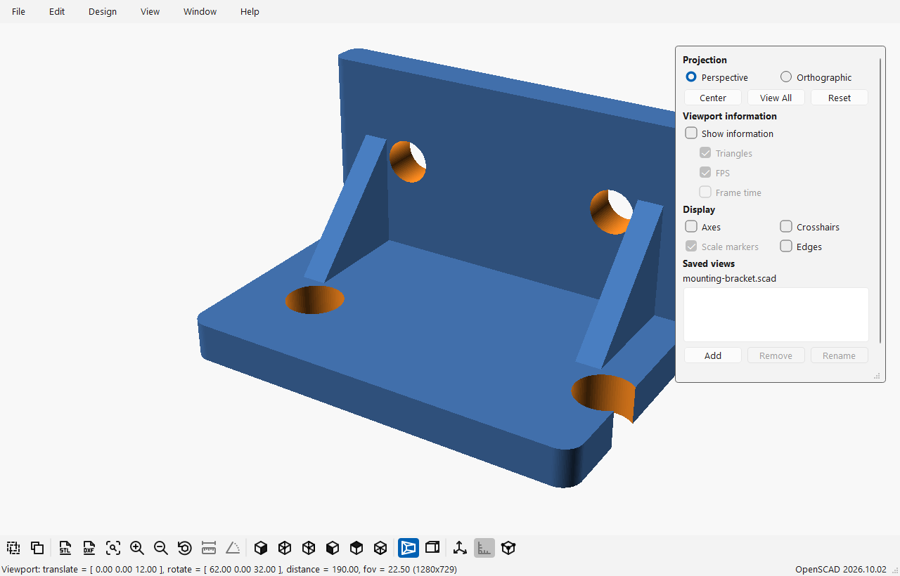

# SCADMaxx

*OpenSCAD, with the sliders turned up.*

SCADMaxx combines regular OpenSCAD with additional features and selected upstream patches.
This repository holds the build recipes, tools, prompts and documentation used to assemble it.

<!-- Hand-maintained by the user. Agents must not regenerate or update this README unless explicitly asked. -->

Click any screenshot to open the full-size image. The examples below use the first integrated SCADMaxx build;
the UI comparisons also show regular OpenSCAD with the same model and layout.

## New features

### Annotations

- Draw directly on the viewport and attach comments to captured images.
- Browse, search and edit annotations, or restore an annotation's camera view.
- Save annotations alongside the SCAD document, with undo/redo support.
- Give local agents access to annotation evidence through an optional API and Python client.

*Mark a defect on the model and explain what needs to change.*

 

### Navigation cube

- Click cube faces, edges and corners to select a view.
- Orbit freely, rotate in steps and switch between perspective and orthographic projection.
- Save, name and recall document-specific camera views.
- Adjust camera transitions and viewport information overlays.

*The cube follows the camera and provides direct view selection.*

 

See saved views and viewport controls

*Keep useful camera positions with the document.*

### Agent access

- Enable a local HTTP API for inspecting open documents and application state.
- Read source snapshots, syntax trees, diagnostics and annotations.
- Control the camera, capture viewport images and access native saved views.
- Use the bundled Python client and agent workflow instructions.
- Work through external file edits and reloads; the API does not write source files or force evaluation.

*Enable local access and copy connection information from the application.*

 

### UI improvements

- Consistent typography and spacing that adapt to font sizes and display scaling.
- Unified icons with light/dark support and configurable status-icon styles.
- A quieter Customizer with restrained group headers, clearer labels and help tooltips.
- Native Preferences tabs and improved spacing and readability across dialogs.
- Independent editor and console content fonts.

*SCADMaxx: clearer controls and a quieter Customizer.*

 

Compare regular OpenSCAD and SCADMaxx

| Regular OpenSCAD | SCADMaxx |
| --- | --- |
|  |  |
|  |  |

*Matched model, camera, window size and display scale. The Customizer shows each version's default presentation.*

### SCADMaxx Launcher

- Manage multiple installed OpenSCAD and SCADMaxx builds in one place.
- Choose which build opens files for each configured extension.
- Discover builds in selected folders and review which ones to include.
- Switch builds from the system tray, with optional startup at sign-in.
- Set up file associations through Windows Default Apps.

*A separate Windows companion utility: choose which installed build opens each file type.*

 

## Included upstream PRs

### Customizable keyboard shortcuts — [#6878](https://github.com/openscad/openscad/pull/6878)

- Search actions and assign keyboard shortcuts through the GUI.
- Handle shortcut conflicts and restore defaults.
- Apply changes across application windows and retain shortcut settings.

*Find an application action and customize its keyboard shortcuts.*

 

### Dynamic dark-mode switching — [#6776](https://github.com/openscad/openscad/pull/6776)

- Respond to light/dark theme changes while OpenSCAD remains open.
- Update widget palettes without restarting the application.
- Provide the theme foundation used by the local UI improvements.

*The same model in dark mode, with a matching dark viewport background.*

Compare the matching light theme

 

## Build status and documentation

The first integrated Windows x64 editor build includes annotations, navigation, agent access, UI improvements and PRs #6878/#6776.
Its source is branch `scadmaxx-20261001`, revision `bcf48145d`.
Screenshots use that integrated source with a documentation-only capture harness.

- [Screenshot sources and capture details](docs/screenshots/sources.json)
- [Workspace guide](docs/workspace.md)
- [Repositories, worktrees and push destinations](docs/git-layout.md)
- [Selected features and PRs](experimental/PR_STACK.md)
- [Update and build instructions](workflows/update-and-build-scadmaxx.md)
