# SCADMaxx

*OpenSCAD, with the sliders turned up.*

SCADMaxx is not a fork of OpenSCAD. It is a build of openscad-master with a collection of experimental patches. These
patches are PR's from OpenSCAD's Github as well as other features that (source code wise) aren't in a state to be merged
and are only to be taken as implementations to investigate in terms of functionality, usability and so on; not as
'proposals' and certainly not integration-ready PR's.

SCADMaxx makes no promises on language compatibility or what features will be in the next version.  That said, I
personally use SCADMaxx for everything I do with OpenSCAD. Its agentic implementation roots range from 'obvious' to
'still visible', but it's perfectly usable in terms of stability, and to me the added functionality more than makes up
for issues.

This repository holds the build recipes, tools, prompts and documentation used to assemble it. Features are all in their
own branches, so are branches that hold upstream PR's and integration fixes for them. So this repo has instructions for
how to integrate/merge those dozens of branches.

<!-- Hand-maintained by the user. Agents must not regenerate or update this README unless explicitly asked. -->

Here is a list of what SCADMaxx has or does over OpenSCAD master (everything compares to the latest dev builds from
master since the last regular OpenSCAD release is so old and missing things that master has, that it's basically
irrelevant at this point):

<!-- Feature template: use ## for the three categories and ### for each user-facing feature.
Within each category, alternate the primary image left/right, starting left.
Keep linked thumbnails and finish each feature with   before the next heading.
New screenshot slots stay commented out until real captures are available.
-->

## Agentic use

### Agent access

<a href="docs/screenshots/agent-access.png">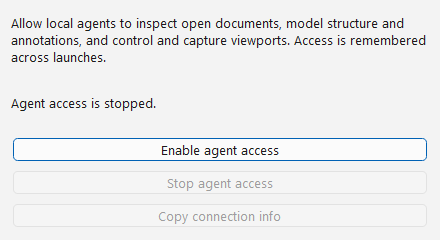</a>

- Enable a local HTTP API for inspecting open documents and application state.
- Read source snapshots, syntax trees, diagnostics and annotations.
- Control the camera, capture viewport images and access native saved views.
- Work through external file edits and reloads; the API does not write source files or force evaluation.

 

### Annotations

<a href="docs/screenshots/annotations.png">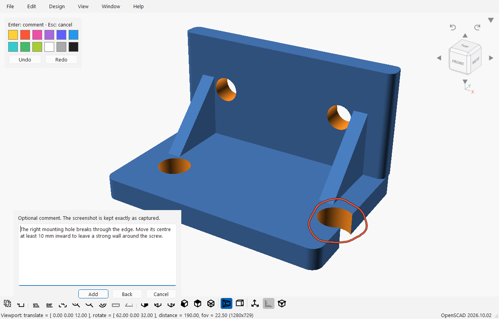</a>

Ever found yourself going in a circle of having your agent change a model, previewing changes in OpenSCAD, 
describing what the issue is and where it happens on the model; or taking a screenshot, pasting into Paint, and
then pasting that back into your agent? Well, no more! Annotate your views straight in SCADMaxx itself!

- Draw directly on the viewport and attach comments to captured images.
- Browse, search and edit annotations, or restore an annotation's camera view.
- Save annotations alongside the SCAD document.
- Local agents directly access your annotations through an HTTP API, and remove it when the issue is fixed, if you want.

 

### OpenSCAD skill

<!-- Screenshot pending: An agent reviewing an annotated model with the SCADMaxx skill.
Uncomment after adding the full-size image; keep the same file in href and src.

-->

- Instructions on how to build clean models, how to do chamfers and fillets.
- How to work with Agent Annotations.
- Work with SCADMaxx specific language features.

 

## UI and UX improvements

### UI improvements

<a href="docs/screenshots/ui-after.png">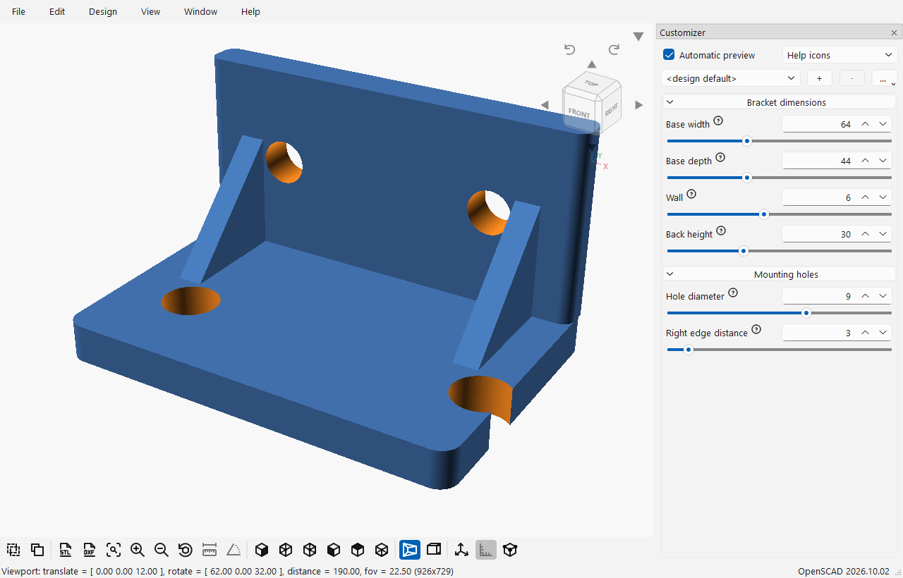</a>

- Consistent typography and spacing that adapt to font sizes and display scaling.
- Unified icons with light/dark support and configurable status-icon styles.
- A quieter Customizer with restrained group headers, clearer labels and help tooltips.
- Native Preferences tabs and improved spacing and readability across dialogs.
- Independent editor and console content fonts.

 

Compare regular OpenSCAD and SCADMaxx

| Regular OpenSCAD | SCADMaxx |
| --- | --- |
| <a href="docs/screenshots/ui-before.png">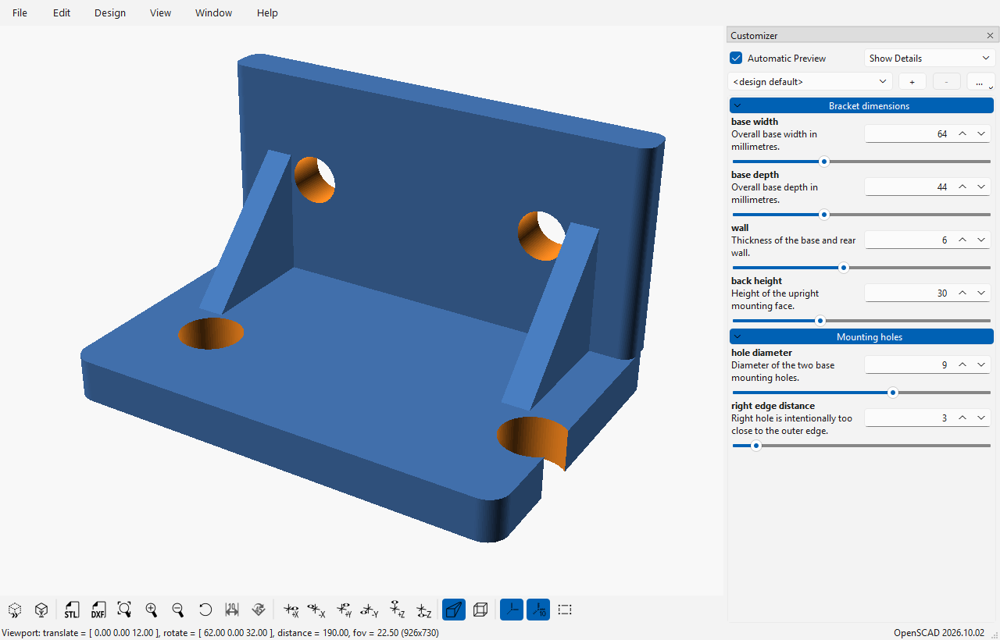</a> |  |
| <a href="docs/screenshots/preferences-before.png">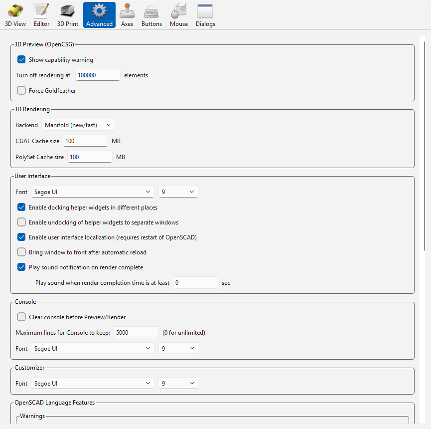</a> | <a href="docs/screenshots/preferences-after.png">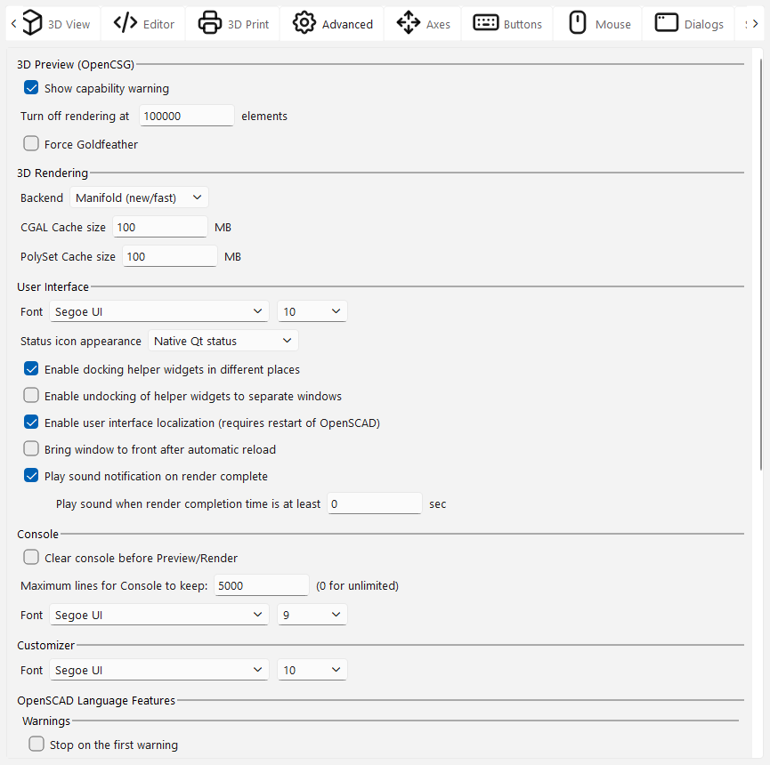</a> |

### Navigation cube

<a href="docs/screenshots/navigation-cube.png">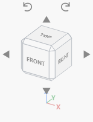</a>

- Click cube faces, edges and corners to select a view.
- Orbit freely, rotate in steps and switch between perspective and orthographic projection.
- Save, name and recall document-specific camera views.
- Additional (optional) viewport information overlays (FPS, tri count etc.).

 

### Model inspection and source navigation

<a href="docs/screenshots/model-inspection.png">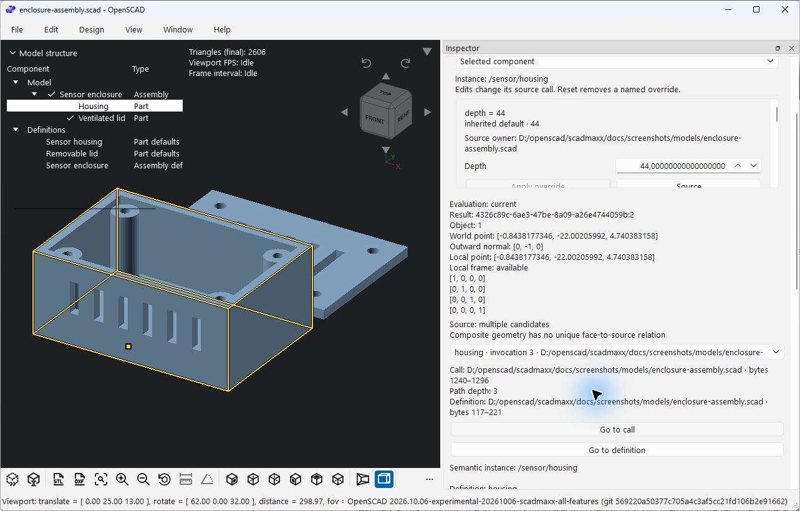</a>

- Pick a surface in the viewport and inspect its position and orientation.
- Find the source call or module definition behind selected geometry and jump to it in the editor.
- See candidate source locations when a rendered surface has more than one possible origin.
- Prepare Inspector data on demand, or enable 'Always prepare Inspector data' in Preferences to collect it during every preview.

 

### Cross sections

<a href="docs/screenshots/live-sections.png">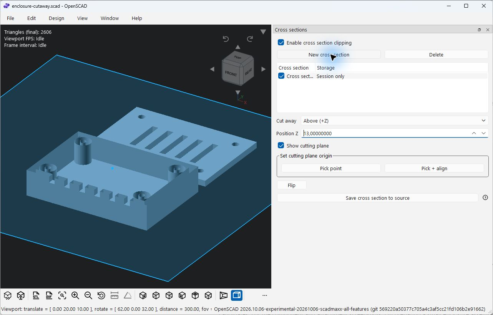</a>

- Look inside a model with cutting planes that clip the viewport without modifying the model geometry.
- Choose which side to cut away and set the plane position numerically, or enter a custom direction.
- Pick a surface point to set the cutting-plane origin, optionally aligning its direction to the surface.
- Keep named cross sections for the session or save their definitions in the SCAD source.

 

### Contextual insertion

<a href="docs/screenshots/contextual-insertion.png">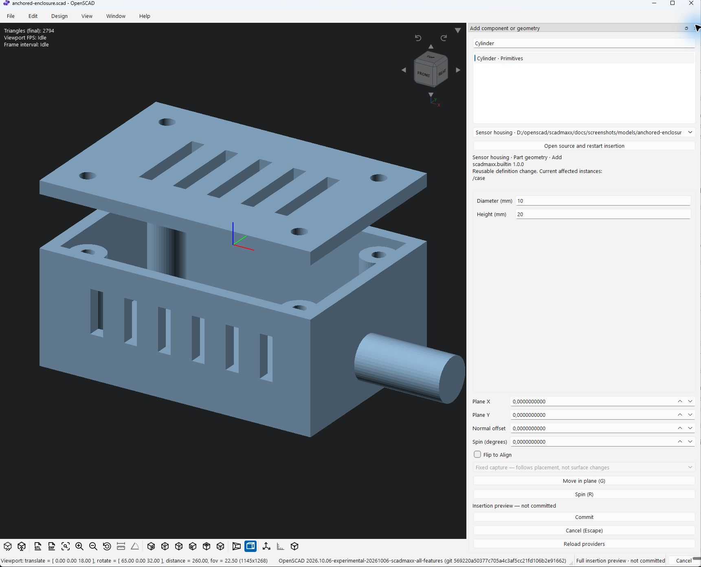</a>

- Pick a surface and press **Shift+A** to add a primitive, hole or hardware component attached to that surface.
- Search the insertion palette, set dimensions, and preview the proposed geometry before committing.
- Drag, rotate or flip the placement, or attach a component to an existing named anchor.
- Commit generates editable SCAD source; one Undo removes the insertion.
- Optional catalog items use separately installed, matching BOSL2 and BOLTS libraries.

 

### Vim editor mode

<a href="docs/screenshots/vim-editor.png">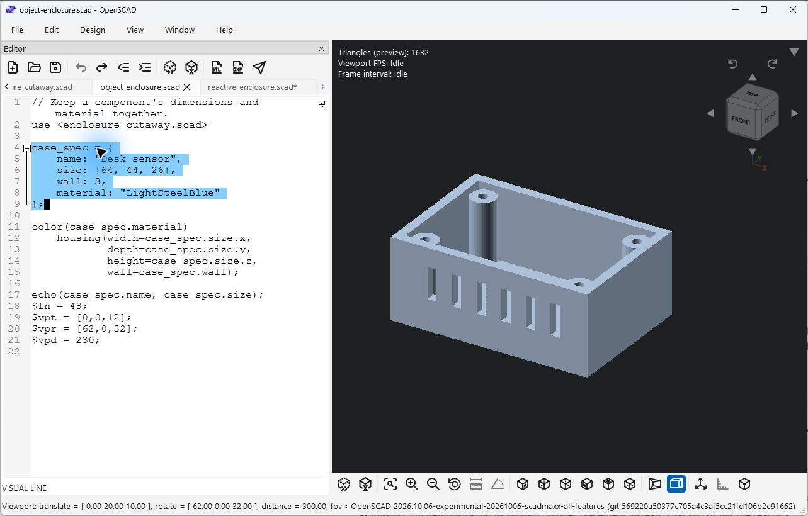</a>

- Enable optional Normal, Insert, Visual and Visual Line modes in the source editor.
- Use familiar motions, text objects, delete/change/yank commands and dot repeat.
- Search with `/` and `?`, and use a small set of `:` commands to save, close, reload or open files.
- Keep the usual editor undo history and application shortcuts.

 

### SCADMaxx Launcher

<a href="docs/screenshots/launcher.png">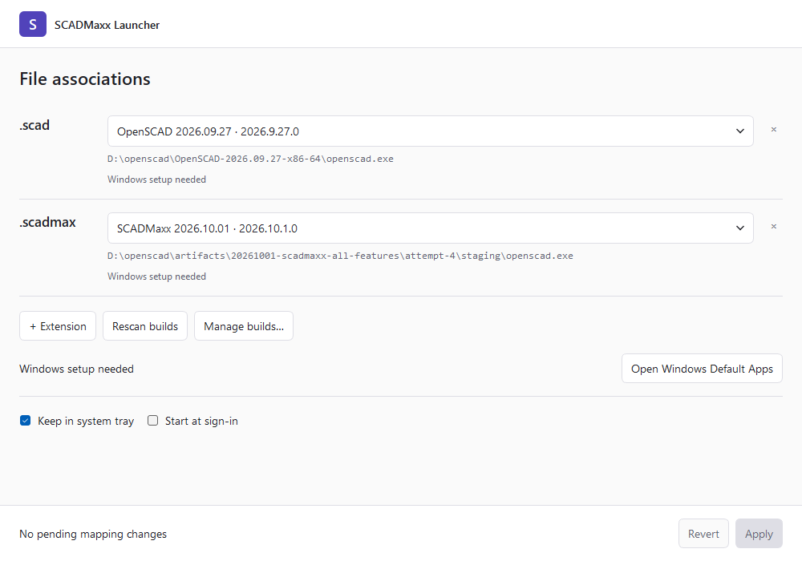</a>

- Manage multiple installed OpenSCAD and SCADMaxx builds in one place.
- Choose which build opens files for each configured extension.
- Useful if you regularly download development builds (or make them yourself) and want to configure what binary is used
  to default-open OpenSCAD or SCADMaxx files.

 

### Customizable keyboard shortcuts — [#6878](https://github.com/openscad/openscad/pull/6878)

<a href="docs/screenshots/shortcuts.png">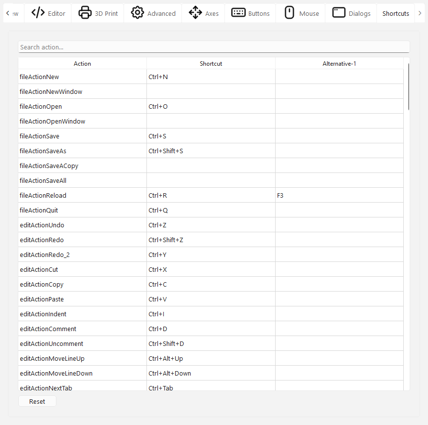</a>

- Assign keyboard shortcuts through the GUI.
- Handle shortcut conflicts and restore defaults.

 

### Dynamic dark-mode switching — [#6776](https://github.com/openscad/openscad/pull/6776)

<a href="docs/screenshots/dark-mode.png">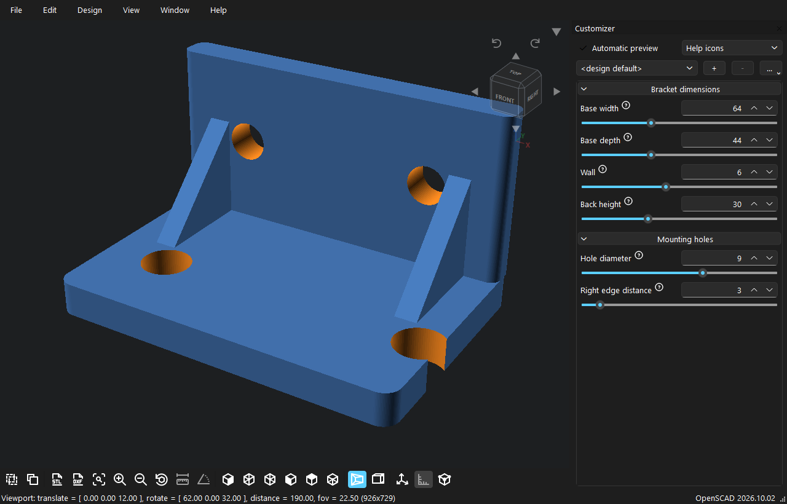</a>

- Much improved handling of theme awareness, including switching themes when the application is running and better use
  of theme colors.

Compare the matching light theme

<a href="docs/screenshots/light-mode.png">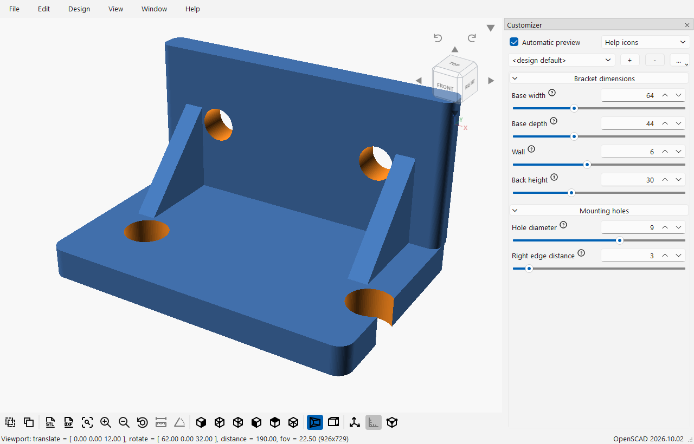</a>

 

### Background preview and rendering

- Calculate previews and rendered geometry in the background while keeping the application responsive.
- Continue editing, navigating the viewport and switching tabs while evaluation runs.
- Cancel evaluations; some geometry operations need to finish before cancellation takes effect.
- Keep the last successful model visible while a replacement is calculated, or when evaluation fails or is cancelled.

 

### Animation export and parallel rendering — [#6963](https://github.com/openscad/openscad/pull/6963) and [#6964](https://github.com/openscad/openscad/pull/6964)

- Export animations directly as animated GIF, APNG or MJPEG/AVI, alongside numbered PNG frames.
- Export from the animation controls or the command line.
- Render command-line animation frames in parallel worker processes using `--animate-processes`.

 

### Transparent image export — [#6951](https://github.com/openscad/openscad/pull/6951)

- Export PNG images with a transparent background for documents, websites and image editors.
- Use transparent backgrounds in command-line exports with `--view=transparent`.
- Combine transparency with APNG animation export.

 

### Colored vector exports — [#7091](https://github.com/openscad/openscad/pull/7091)

- Preserve colors assigned with `color()` when exporting 2D geometry to SVG, PDF and DXF.
- Produce colored drawings directly from the model without recoloring the exported shapes manually.

 

## OpenSCAD language additions

### Object literals and comprehensions — [#6081](https://github.com/openscad/openscad/pull/6081)

[Usage and examples](docs/language-objects.md)

<a href="docs/screenshots/objects.png">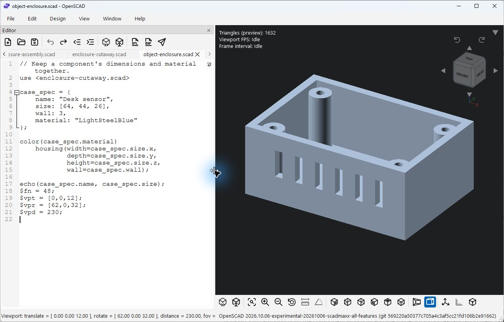</a>

- Group named values in objects using `{key: value}` literals.
- Read members with dot or bracket notation.
- Build objects with comprehensions and computed keys, and derive updated objects with `object()`.

 

### Native Customizer attributes — [#6642 variant](https://github.com/openscad/openscad/pull/6642)

[Usage and examples](docs/language-customizer-attributes.md)

<a href="docs/screenshots/customizer-attributes.png">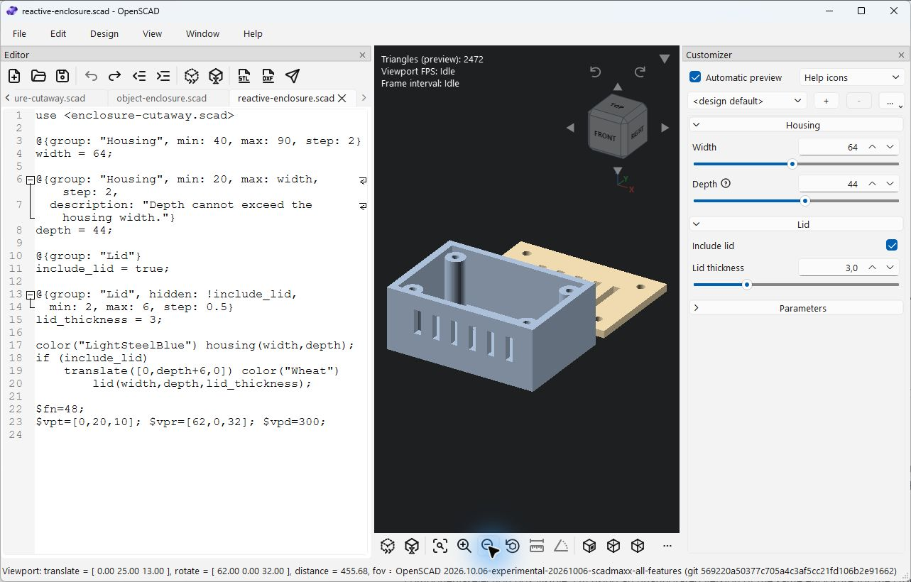</a>

- Describe parameters with `@{key: value}` blocks directly above their assignments.
- Set groups, descriptions, ranges and numeric widget options in source.
- Use expressions to hide or lock parameters as other values change - a much more dynamic Customizer!.

 

### Parts, assemblies and components

[Usage and examples](docs/language-parts-assemblies.md)

<a href="docs/screenshots/parts-assemblies.png">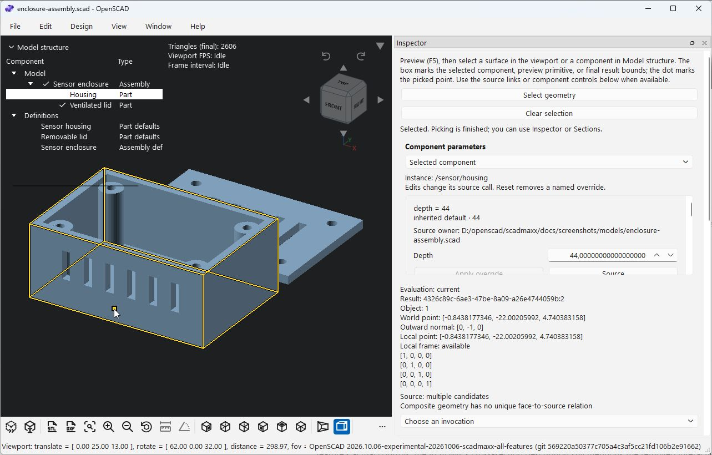</a>

- Mark module definitions as Parts or Assemblies, and their placed calls as Components.
- Give instances explicit identities and browse them in the Model tree.
- Inspect and edit supported per-instance parameters or definition defaults through the Customizer.
- Hide or solo parts for inspection, and export a selected component or assembly in local or placed coordinates.

 

### Anchors and attachments

[Usage and examples](docs/language-anchors-attachments.md)

<a href="docs/screenshots/anchors-attachments.png">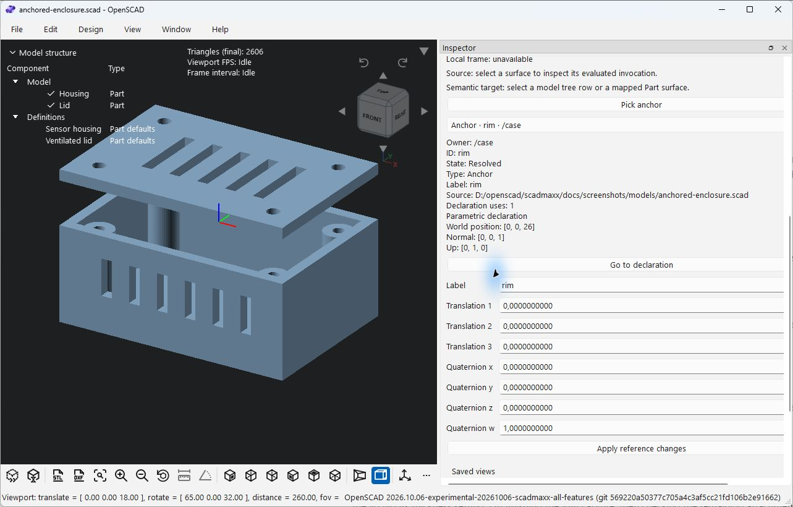</a>

- Declare named points, axes, planes and oriented anchors in SCAD source.
- Mate or align components through anchor references, with offset and spin adjustments.
- Let parametric anchors move attached components when dimensions change.
- Pick a surface to create an anchor draft, then save its declaration into the source.

 

### Geometry bounds - [selected from #4478](https://github.com/openscad/openscad/pull/4478)

[Usage and examples](docs/language-geometry-bounds.md)

- Capture a shape with `{{ ... }}` and query it from SCAD code using `geometry_bounds()`.
- Read its bounding-box `min`, `max`, `size`, and `center` as ordinary object members.
- Use these values to position other geometry, calculate clearances, or size an enclosure without repeating dimensions.
- `center` is the bounding-box midpoint, not the center of mass.

## Installation

Only Windows builds are provided at the moment. If there is demand, I can look into doing cross platform builds. If you
are on another platform and want to build it yourself, you can also tell your agent to clone this repo and execute the
procedures described.

Builds are date-based, there is no regular release schedule. Have suggestions for patches or functionality that would
fit in an experimental build like this? File an issue.

To install, give your agent this prompt:

    Download the latest release zip of SCADMaxx from http://github.com/roel-v/SCADMaxx. Unzip it in a suitable working
    directory, into a subdirectory thereof with a name derived from the downloaded zip file. Install the agent skill
    you'll find in that installation folder. Report where you installed it afterward.

Or specify where you want it to install, of course.
