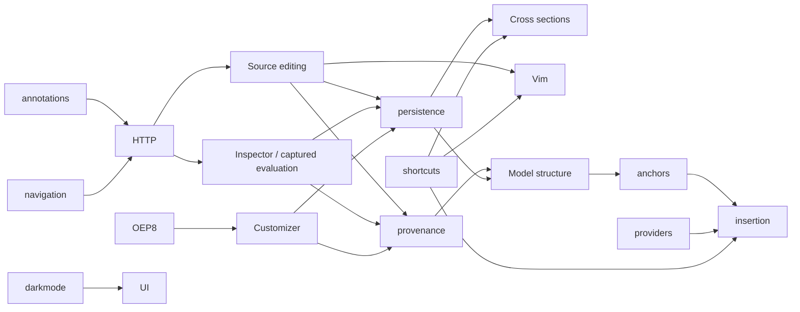

# Maintained feature ancestry

The 2026-10-06 migration replaces copied prerequisite snapshots with real forward merges. Existing branch history
and worktrees remain in place. No cherry-picks, resets, rebases, pushes, builds or tests were performed.
Local migration heads are **not validated or promoted**. SOURCES.json retains the older evidence separately.

The authoritative machine-readable dependency pins are [DEPENDENCIES.json](../experimental/DEPENDENCIES.json).
The table below is the migration checkpoint; use the manifest and Git for subsequent revisions.

| Feature | Branch/ref | Accepted checkpoint | Direct prerequisites |
| --- | --- | --- | --- |
| pr-6878 | `refs/experimental-runs/20261005-scadmaxx-all-features/pr-6878` | `3014fb554` | upstream + existing build support |
| pr-6776 | `refs/experimental-runs/20261005-scadmaxx-all-features/pr-6776` | `aab4aed03` | upstream + existing build support |
| navigation-cube | `refs/heads/feature/navigation-cube` | `6b42cbf3f` | upstream + existing build support |
| ui-visual-polish | `refs/heads/codex/ui-visual-polish` | `6096a42d2` | pr-6776 |
| annotations | `refs/heads/feature/annotations` | `d670fad09` | upstream + existing build support |
| http-agent-server | `refs/heads/codex/http-agent-server` | `f2c9de2c9` | annotations, navigation-cube |
| pr-6081 | `refs/experimental-runs/20261005-scadmaxx-all-features/pr-6081` | `07b22af25` | upstream + existing build support |
| pr-6642-oep8 | `refs/heads/codex/pr6642` | `306c92d39` | pr-6081 |
| source-editing-foundation | `refs/heads/feature/source-editing-foundation` | `248875667` | http-agent-server |
| selection-model-inspector | `refs/heads/feature/selection-model-inspector` | `5cffc4744` | http-agent-server |
| vim-editor-mode | `refs/heads/feature/vim-editor-mode` | `0c00d53b5` | source-editing-foundation, pr-6878 |
| source-geometry-provenance | `refs/heads/feature/source-geometry-provenance` | `bd4edb39b` | source-editing-foundation, selection-model-inspector, pr-6642-oep8 |
| design-object-persistence | `refs/heads/feature/design-object-persistence` | `4652ee8a8` | source-editing-foundation, selection-model-inspector, pr-6642-oep8 |
| live-clipping-sections | `refs/heads/feature/live-clipping-sections` | `03e99c7d5` | design-object-persistence, pr-6878 |
| geometry-services | `refs/heads/feature/geometry-services` | `4e1286c7b` | upstream + existing build support |
| component-provider-adapters | `refs/heads/feature/component-provider-adapters` | `9d0cb2097` | upstream + existing build support |
| semantic-model-hierarchy | `refs/heads/feature/semantic-model-hierarchy` | `49bc5f247` | source-geometry-provenance, design-object-persistence |
| anchors-attachments | `refs/heads/feature/anchors-attachments` | `e1ebaa4c9` | semantic-model-hierarchy |
| contextual-insertion | `refs/heads/feature/contextual-insertion` | `99d6d7d4e` | anchors-attachments, component-provider-adapters, pr-6878 |

Inspector and Cross sections now share actual owner ancestry. Both the cheap viewport freshness fix and the HTTP
camera-publication fix arrive through those dependencies. Cross sections also retains its cutting-plane/deletion
fixes, terminology changes and shared branch-title patch. The optional model tree changes are retained in hierarchy.
Existing application binaries have not changed.

## Everyday feature maintenance

The continuous source-editing follow-up is source editing `0bcafded2` (hidden widgets
are disabled for input without changing document read-only protection), persistence
`5e048d5aa` (current-buffer records, guarded source patches and undo/redo, readable
inserted declarations), merged into Cross sections `d46392073`. The consumer's
pending UI changes use those records for repeated edits and retain the last displayed
clipping pipeline; picking still requires evaluated geometry. Run and source snapshot:
`runs/20261006-section-promotion-display` in the container. Build results belong in
that report; no runtime tests or promotion are implied by these pins.

The hidden-Editor session-edit fix is owned by source editing (`5c67b8c4a`, with
regression correction `6421dc080`), merged forward into persistence (`d97af002b`)
and Cross sections (`db0188a70`). A hidden Editor dock sets Scintilla read-only;
participant-only transactions must remain available without permitting text edits.
The standalone Cross sections build and hidden-Editor/open-CSG GUI regression pass,
as do 7 source-editing cases (93 assertions), including session undo/redo and rejected
source edits. Evidence: `runs/20261006-section-open-example-debug` in the container.
The runtime contains the pending Cross sections UI/branding changes; the last
forward merges change only the unit test. Other consumers retain their previous
dependency pins, and no promotion or full-feature validation is implied.

The subsequent empty-document change is persistence commit `7cbbf6c88`, merged forward into Cross sections
as `e10bb191d`. It permits independent transient Section edits without evaluated geometry. The current local
pins record these heads; validation and promotion remain unchanged. Feature UI edits are still uncommitted.

On 2026-10-06, persistence commit `912e292c0` removed persistent Section target/frame references.
Cross sections merged it normally in `a736cdb5b`, including the required world-space pose-edit adapter.
These are local, unbuilt and untested; promotion/validation pins remain unchanged. Pending UI and branding
edits remain uncommitted in Cross sections. Other consumers retain their recorded older persistence pins
until an explicit forward integration; do not silently relabel those dependencies as updated.

1. Run `experimental/scripts/Get-FeatureAncestry.ps1` from controls to inspect accepted, available-local, promoted
   and validated revisions separately. For original PRs, available-local means the retained checkpoint, not a fresh
   GitHub lookup. Inspect worktree status/submodules before making changes; the inventory script does not fetch.
2. Make a shared fix in its owning foundation. Feature-specific integration hooks may live with their consumer;
   generic contracts belong to the owner. Do not fix copied foundation implementations independently in consumers.
3. Commit only when authorized. Merge the actual committed owner ref into each affected consumer using
   `git merge --no-ff --no-commit <owner-ref>`, review the diff and commit the merge. Work bottom-up in the graph.
   Do not cherry-pick, squash, replace a consumer's complete files, or merge an entire consumer backwards.
4. Preserve each consumer's additions. Check its source hooks, registrations and both sides of a conflict. Ancestry
   alone does not prove behavioral equivalence. Stop for a user answer if feature behaviors conflict.
5. Record the resulting accepted consumer SHA and exact prerequisite SHAs in DEPENDENCIES.json; update the pinned
   PR_STACK revision and SOURCES local/accepted head. Keep validation and promotion unchanged until they happen.
   New prerequisite revisions do not inherit old validation. No builds/tests until the user requests them.
6. Merge forward again if an owner changed during reconciliation. Before a standalone build, report any owner tip
   absent from the consumer, local/accepted mismatch, dirty changes and outstanding validation. Do not call a build
   current simply because it has an older ancestor of the right branch.

The maintained native DAG is:

Navigation, annotations, providers and geometry services remain independent owners. Their existing Windows build
support stays in history; no optional all-features foundation was introduced. The performance experiment remains
independent and unselected. Branding/title patches remain canonical control assets, not feature dependencies.
For future work: drawings require anchors + geometry; interactive editing requires anchors; agent geometry analysis
provisionally requires anchors + geometry, pending its scope decision. Startup reopening has no such dependency.
The launcher and agent skill live in the control repository, outside this native DAG.

## One-time ownership reconciliation

The old snapshots were reconciled against their original copied implementations, not with a blanket ours/theirs
merge strategy. Original PR merges retain reviewed local adaptations (native theme/icons, parser occurrence tracking,
Customizer group visibility and modern upstream APIs). Recovery refs preserve all original source branch tips under
`refs/archive/ancestry-20261006/`; binary patches and untracked-file backups are under the run's `before/` directory.
Generated submodule edits and HTTP untracked files were left in place and excluded from source commits.

| Former follow-up | Maintained ownership |
| --- | --- |
| Semantic foundation `e1d33c876` | Source editing: guarded transactions/undo; Inspector: native execution gate, captured cache; provenance: captured source navigation; persistence: reference checks |
| Anchor foundation `af0948f5d` | Object syntax: duplicate-key diagnostics; persistence: consumer records, drafts and lifecycle; hierarchy: placement hooks; Inspector: renderer restoration and dock layout |
| Insertion foundation `2895ab7f8` | Inspector: sealed inputs, parser/capability guards, draft display, focus sessions and captured parameter API; provenance: parser occurrence regression; hierarchy: draft ownership checks |
| Cross-section shared follow-ups | Inspector: mesh-upload diagnostics; persistence: coalescing absolute draft fields |

Customizer reactive-state refresh remains a composition hook where Customizer is present. Inspector's generic
captured-value API has no dependency on that optional PR. Tests were relocated/adapted with their owner contracts,
but were not executed. The existing insertion Windows unit-resource adjustment remains in its history and continues
to be supplied by that selected head; it is build support rather than a separate product feature.

The three foundation-followup stack rows are retired because their behavior is accounted for above and their
commits remain in consumer histories. Do not apply those historical patches again.
The migration deliberately retains append-only checkpoints, including corrective commits for transient conflict
markers/duplicate declarations encountered during reconciliation. Final tips were inspected for unresolved merge
state; intermediate checkpoints are not claimed to be buildable.

## Release integration and promotion

[The input contract](../experimental/integration-inputs.md) now requires normal merges of frozen native heads.
Preparation rejects omitted prerequisite rows, different accepted dependency revisions and known excluded features
hidden in ancestry. Fresh releases still start from freshly fetched upstream master. Review comparisons are evidence,
not patches to apply. `git log --first-parent` gives the concise integration/repair sequence.

No Dropbox or GitHub refs were changed during this migration. A later build must not silently use older promoted
heads or claim these local heads are ready. Validate when requested; promote only on explicit push authorization,
then update readiness against verified bare refs. Historical runs keep their frozen controls and old delta rules.

Full preservation and resulting source heads: [migration run](../../runs/20261006-ancestry-migration/report.md).
