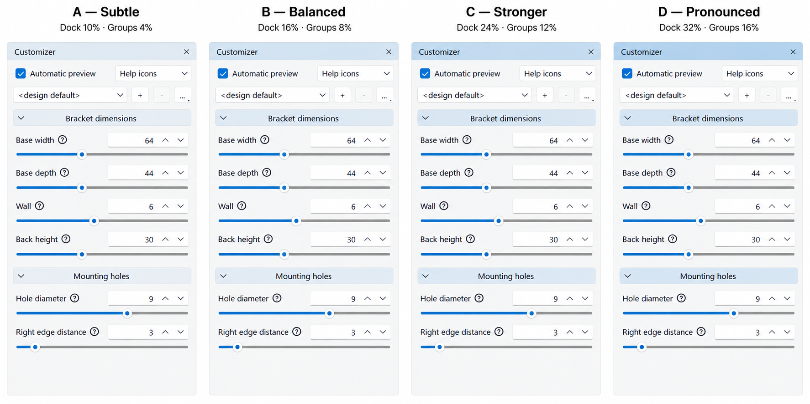
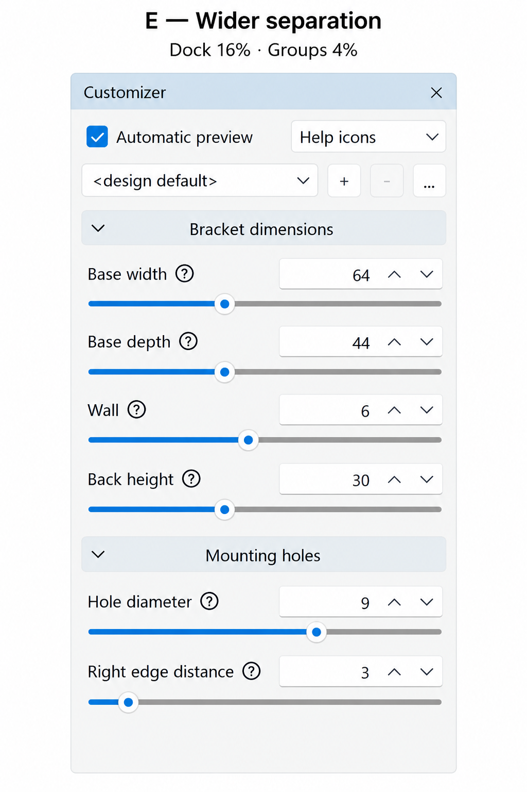

# SCADMaxx style guide and UI conventions

## Dock and Customizer header hierarchy — option E

Selected by the user on 2026-10-10: **E — Wider separation**. Use a 16% Accent blend for the
dock title background and a 4% Accent blend for resting Customizer group headers:

`surface = (1 - amount) * Window + amount * Accent`

The dock title identifies the containing panel; group headers identify subdivisions. Giving the
dock title the stronger tint reinforces that hierarchy while keeping repeated group headers quiet.
Leave the panel content untinted. In the light-theme previews, the dock title is the darkest surface.
Derive actual colors from the live theme palette; the illustrative RGB values are not constants to ship.
Check the hierarchy and text contrast separately in dark themes, where accent blending need not darken a surface.

| Option | Dock title Accent | Group header Accent | Decision |
| --- | ---: | ---: | --- |
| A — Subtle | 10% | 4% | Considered |
| B — Balanced | 16% | 8% | Considered |
| C — Stronger | 24% | 12% | Considered |
| D — Pronounced | 32% | 16% | Considered |
| E — Wider separation | 16% | 4% | **Selected** |

For the illustrative palette Window `#F0F0F0`, Accent `#0078D4`, E gives dock `#CADDEC`
and groups `#E6EBEF`. The following are AI-generated mockups based on the saved README screenshot,
not captures of implemented styling. Minor rendering differences are illustrative.

Source screenshot: [Customizer/UI after](screenshots/ui-after.png); capture provenance is in
[screenshots/sources.json](screenshots/sources.json). Mockups were generated with the built-in imagegen
tool on 2026-10-10. The first prompt varied only title/group fills across A–D; the second retained B's
16% dock title and substituted A's 4% group fills. Saved mockups preserve the decision history independently
of future replacement of the README screenshot.

**Implementation:** the coordinated UI branch applies E: dock titles use 16% Accent, while Customizer
groups use 4% at rest, 6% on hover and 8% while pressed. These state values keep group emphasis below
the parent title. Shared dock titles preserve native dragging, floating, closing and double-click docking.
Disabled and high-contrast controls retain native drawing. Saved mockups are design history, not release captures.

### Qt palette and dock title rules

- Use semantic palette roles and the appropriate Active, Inactive or Disabled palette group. Accent is the
  theme accent; Highlight denotes selection. Pale header surfaces should retain a contrasting normal
  foreground rather than automatically using HighlightedText. Qt does not prescribe the blend percentages
  or the parent/child hierarchy; those are SCADMaxx decisions.
- When docked, the default `QDockWidget` title is drawn by Qt and can be styled without installing a custom
  title widget. When floated with native window decorations, the operating system controls the title bar;
  a dock stylesheet does not recolor that native title bar.
- A custom title widget installed with `QDockWidget::setTitleBarWidget()` suppresses native decorations
  while floating and lets SCADMaxx use the same palette-derived title surface in both states. This is a
  dock title bar, not a toolbar. Preserve close/float actions, dragging, double-click docking, accessible
  names and style-based sizing. Unhandled mouse events must be ignored so QDockWidget can process them.
- Continue the live-palette, native-control and high-contrast requirements below. On 2026-10-10 the user
  selected a custom dock title bar, implemented together with the Preferences consistency work. See the
  [coordinated exploration](../.plans/2_in-progress/2026-10-10_preferences-and-dock-consistency/1_exploration.md).

References: [QPalette roles](https://doc.qt.io/qt-6/qpalette.html),
[dock stylesheet support and floating limitation](https://doc.qt.io/qt-6/stylesheet-reference.html#qdockwidget),
[custom dock title widgets](https://doc.qt.io/qt-6/qdockwidget.html#setTitleBarWidget).

## Qt drawing and Customizer section surfaces — previous implementation

Qt palette roles are semantic inputs to a style, not an inventory of all colors rendered by Windows.
The style can derive brushes from those inputs; there need not be a dedicated pale accent palette role.
See [Qt style drawing](https://doc.qt.io/qt-6/style-drawing.html).

For Customizer disclosure headers, use the existing `GroupWidget` with its dedicated `GroupDisclosureButton`:

- Previous implemented blend of `Window` with `Accent`: 10% accent at rest, 16% on hover, 22% while pressed.
  Press takes precedence over hover. Expanded and collapsed headers use the same resting surface.
- Recompute from the style option's current palette each paint. Never cache a light-mode RGB value or
  install the blend on the widget/application palette. Child controls retain their own semantic colors.
- Set only the temporary option's `Button` brush, then draw `CC_ToolButton` through `QStylePainter`.
  Retain native borders, arrow, text, focus, metrics, keyboard activation and accessible disclosure state.
- Keep the button non-checkable: an expanded group is not a selected item. Leave the content area untinted.
- Use native drawing without tint for disabled controls and the platform's high-contrast preference.
  The implementation uses the current Qt 6.11.1 toolchain (accessibility hints require Qt 6.10).

This localized surface treatment was approved on 2026-10-07. It is not a global palette or stylesheet change.
The previous checkable toolbutton received a strong checked/accent fill from the Windows 11 style;
removing checkability removed that fill but made the section header too neutral.

Qt's Windows 11 `controlFillBrush()` honors an explicit `Button` brush before its own state fills, so the
custom control must supply its hover and press colors as well. Other styles decide how they consume roles;
do not assume this produces identical pixels across all platforms.

References (also kept beside `GroupDisclosureButton::paintEvent` in the source):

- [QWidget palette semantics](https://doc.qt.io/qt-6/qwidget.html#palette-prop)
- [Live color scheme and palette updates](https://doc.qt.io/qt-6/qstylehints.html#colorScheme-prop)
- [QStylePainter complex controls](https://doc.qt.io/qt-6/qstylepainter.html#drawComplexControl)
- [Platform contrast preference](https://doc.qt.io/qt-6/qaccessibilityhints.html#contrastPreference-prop)
- [Qt 6.11.1 Windows 11 style source](https://github.com/qt/qtbase/blob/v6.11.1/src/plugins/styles/modernwindows/qwindows11style.cpp)

## Help icon

When the user says "help icon", use the Customizer's circled-question-mark icon and interaction.
Do not substitute a platform-standard help button, a text question mark, or a newly drawn symbol.

- Artwork: `resources/icons/tabler/stock/help-circle.svg`, mapped to `help` in the UI-polish
  checkout's `resources/icons/tabler/mapping.json`. Preserve the adjacent Tabler MIT license.
- Reference implementation: `ParameterDescriptionWidget` in
  `D:/openscad/wt-openscad-ui-visual-polish/src/gui/parameter/ParameterVirtualWidget.cc`.
- Use `Icons::setLabelIcon(..., "help", ...)` where the shared icon library is present.
  Size with the style's small-icon metric, use the theme foreground color, and keep the background transparent.
- Display the explanatory text as a native, wrapping tooltip on hover (250 ms delay) or click.
  Hide it on leaving or hiding the icon. Provide an accessible name and description.
- Keep it visually lightweight and beside the control or group it explains.

The standalone Cross sections branch embeds the same unmodified SVG and uses a small local tooltip button
because it does not depend on UI polish. This does not introduce a UI-polish ancestry dependency or copy its
icon framework. When composing branches, preserve the identical artwork and theme-aware rendering.
